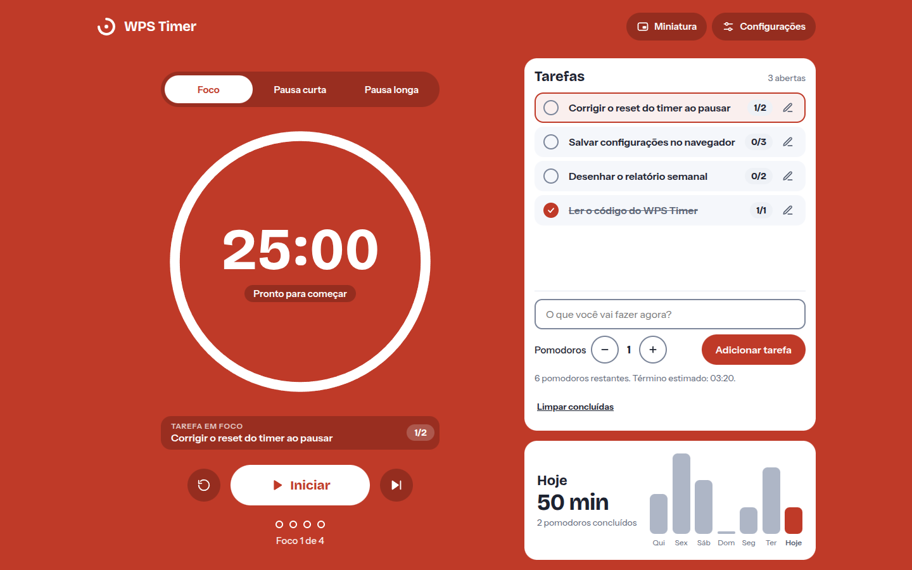
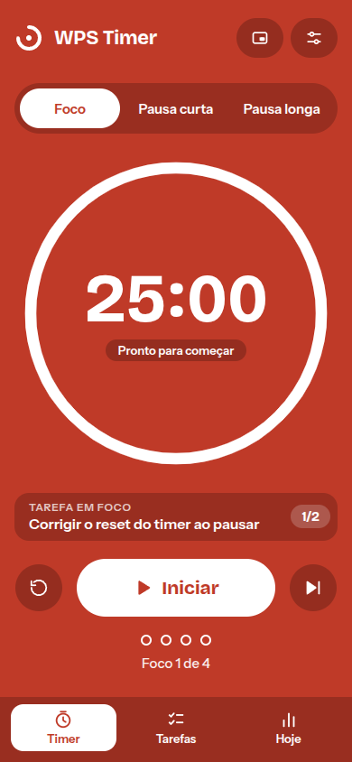

<div align="center">
    <br/>
    
    <br/>
    <br/>
    
    <br/>
</div>

<br/>

# WPS Timer

<p align="center">
  <a href="https://reactjs.org/"></a>
  <a href="https://developer.mozilla.org/docs/Web/HTML"></a>
  <a href="https://developer.mozilla.org/docs/Web/CSS"></a>
  <a href="https://nextjs.org/"></a>
</p>

Timer for the Pomodoro method of time management, with a task list, daily stats and a floating mini timer. It gives an audible alert and a notification when the time is up.

The application is hosted on Vercel and can be accessed at [https://wps-timer.vercel.app/](https://wps-timer.vercel.app/). The interface is in Brazilian Portuguese.

## Features

- **Three modes:** focus, short break and long break, with a cycle counter. After a set number of focus sessions (4 by default) the next break is the long one.
- **Tasks:** add tasks with a pomodoro estimate, pick the one in focus, edit, complete or delete them. Each finished focus session counts for the task in focus, and the app estimates when the remaining pomodoros will end.
- **Today:** minutes and pomodoros finished today, plus a chart of the last 7 days.
- **Settings:** duration of each mode, how many focus sessions come before a long break, automatic start of breaks and focus sessions, alarm sound (Sino, Madeira or Digital) and browser notifications. The browser only asks for notification permission after you turn them on.
- **Floating mini timer:** a small always-on-top window (Picture-in-Picture) with the time and the start/pause, reset and skip buttons, so the timer stays visible while you use other tabs. It needs a desktop Chromium browser (Chrome or Edge); the button is hidden elsewhere.
- **Tab title and favicon:** the tab reads `WPS Timer · 24:57 Foco` while a countdown runs, and the favicon changes color with the current mode.
- **Responsive:** two columns on wide screens; on narrow screens a single column with a bottom bar to switch between Timer, Tasks and Today.
- **Saved in your browser:** settings, tasks and daily stats are kept in `localStorage`. Nothing is sent to a server.
- **Accessible:** keyboard navigation, labels for screen readers, a focus trap in the settings dialog and support for reduced motion.

## Running locally

Requires Node.js 20 or newer (tested on 20 and 22). Clone the repository and run:
```sh
yarn
yarn dev
```
This installs the required modules and launches the application on [http://localhost:3000](http://localhost:3000).

The `dev` and `build` scripts set `NODE_OPTIONS=--openssl-legacy-provider`, which Next 11 needs on Node.js 17 and newer.

## Project structure

```
pages/index.tsx           the page: composes the interface, sets the tab title and favicon
components/               interface pieces (TimerPanel, TasksCard, TodayCard, SettingsDialog, MiniTimer, ...)
lib/useWpsTimer.ts        timer state and actions
lib/usePip.ts             floating Picture-in-Picture window
lib/storage.ts            saving and loading data in localStorage
lib/sound.ts              alarm sounds, generated with the Web Audio API
lib/pomodoro.ts           types, themes and helpers
lib/favicon.ts            favicon in the color of the current mode
styles/globals.css        layout and breakpoints
```

## Deploy

The `main` branch is deployed automatically by Vercel. The Vercel project uses Node.js 22.x.

Enjoy efficient time management with the WPS Timer!
